<div align="center">
  
</div>

<br>

-----

<div align="center">
  <strong>Catálogo visual dos 49 assets editoriais incluídos no pacote PyStSlides (11 <code>PNG</code>, 19 <code>SVG</code> estáticos e 19 <code>SVG</code> animados).</strong>
</div>

<br>

<p align="center">
  <a href="./README.md">README</a> •
  <a href="./TUTORIAL.md">Tutorial</a> •
  <a href="./examples/README.md">Exemplos</a>
</p>

-----

<br>

## **Como Usar os Assets**

Você pode usar as ilustrações diretamente do pacote instalado ou exportá-las para uma pasta local:

```python
from pystslides import Presentation, get_editorial_assets_dir

with Presentation(title="Minha Apresentação", assets_dir=get_editorial_assets_dir()) as deck:
    deck.cover(title="Título", image="discovery_cover.png", image_position="right")
    deck.split_slide("Arquitetura", "Fluxo distribuído.", media="api_gateway.svg")
    deck.split_slide("Fluxo Animado", "Versão animada.", media="api_gateway_animated.svg")
```

```bash
# Copie todos os 49 assets para ./assets (ou filtre com --format svg_animated / svg_static)
pystslides-assets ./assets
```

<br>

## **Catálogo Estático (`PNG` e `SVG` — 30 itens)**

<table>
  <tbody>
    <tr>
      <td align="center" width="33%">
        <br>
        <code>access_desk.png</code>
      </td>
      <td align="center" width="33%">
        <br>
        <code>access_governance.svg</code>
      </td>
      <td align="center" width="33%">
        <br>
        <code>ai_pipeline.png</code>
      </td>
    </tr>
    <tr>
      <td align="center" width="33%">
        <br>
        <code>ai_shield.svg</code>
      </td>
      <td align="center" width="33%">
        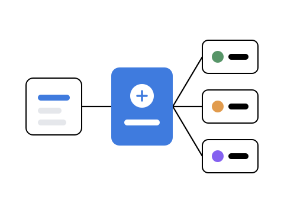<br>
        <code>api_gateway.svg</code>
      </td>
      <td align="center" width="33%">
        <br>
        <code>classification_network.png</code>
      </td>
    </tr>
    <tr>
      <td align="center" width="33%">
        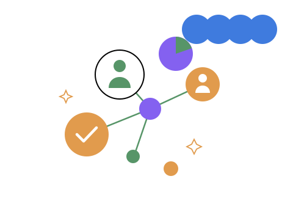<br>
        <code>classification_nodes.svg</code>
      </td>
      <td align="center" width="33%">
        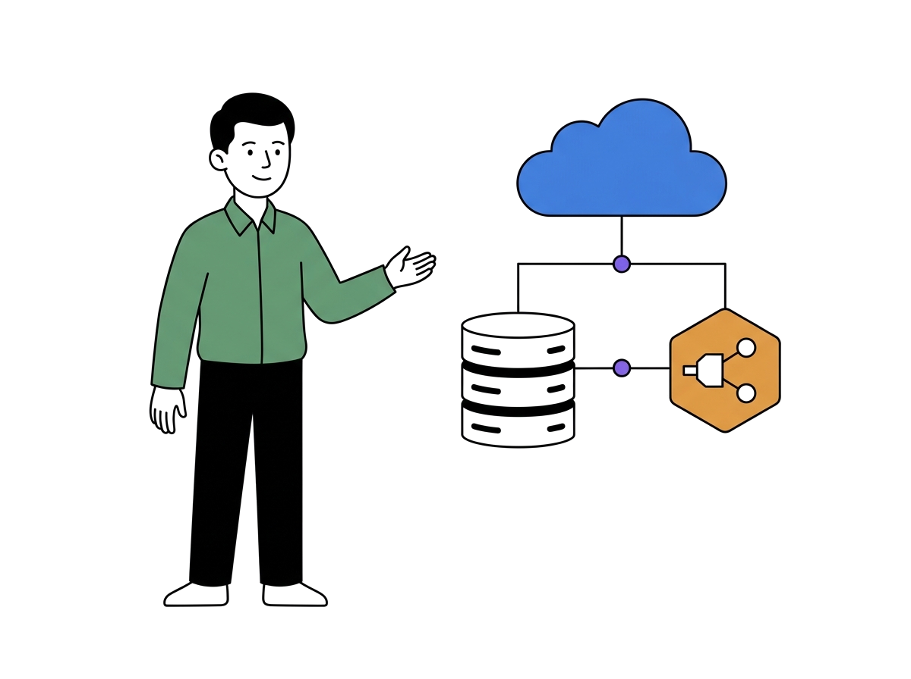<br>
        <code>cloud_architecture.png</code>
      </td>
      <td align="center" width="33%">
        <br>
        <code>cloud_nodes.svg</code>
      </td>
    </tr>
    <tr>
      <td align="center" width="33%">
        <br>
        <code>code_review.svg</code>
      </td>
      <td align="center" width="33%">
        <br>
        <code>coverage_laptop.png</code>
      </td>
      <td align="center" width="33%">
        <br>
        <code>coverage_workspace.svg</code>
      </td>
    </tr>
    <tr>
      <td align="center" width="33%">
        <br>
        <code>database_cluster.svg</code>
      </td>
      <td align="center" width="33%">
        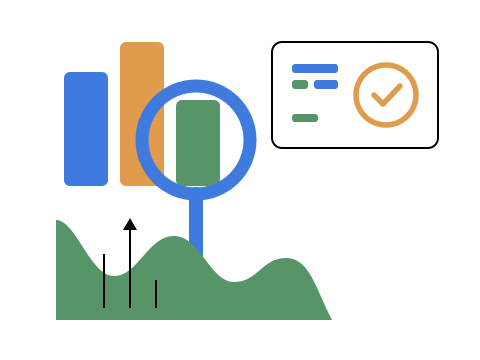<br>
        <code>discovery_analytics.svg</code>
      </td>
      <td align="center" width="33%">
        <br>
        <code>discovery_cover.png</code>
      </td>
    </tr>
    <tr>
      <td align="center" width="33%">
        <br>
        <code>event_bus.svg</code>
      </td>
      <td align="center" width="33%">
        <br>
        <code>interactive_quiz.svg</code>
      </td>
      <td align="center" width="33%">
        <br>
        <code>lock_verification.svg</code>
      </td>
    </tr>
    <tr>
      <td align="center" width="33%">
        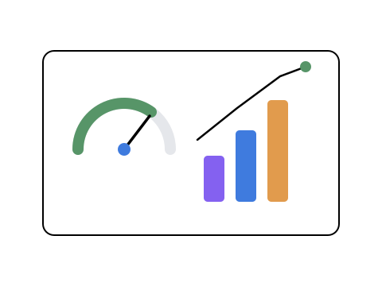<br>
        <code>metrics_dashboard.svg</code>
      </td>
      <td align="center" width="33%">
        <br>
        <code>ml_training.svg</code>
      </td>
      <td align="center" width="33%">
        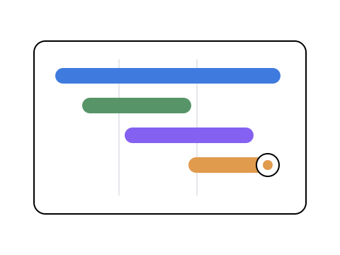<br>
        <code>observability_traces.svg</code>
      </td>
    </tr>
    <tr>
      <td align="center" width="33%">
        <br>
        <code>performance_growth.png</code>
      </td>
      <td align="center" width="33%">
        <br>
        <code>remediation_analytics.png</code>
      </td>
      <td align="center" width="33%">
        <br>
        <code>remediation_automation.svg</code>
      </td>
    </tr>
    <tr>
      <td align="center" width="33%">
        <br>
        <code>roadmap_planning.png</code>
      </td>
      <td align="center" width="33%">
        <br>
        <code>security_audit.png</code>
      </td>
      <td align="center" width="33%">
        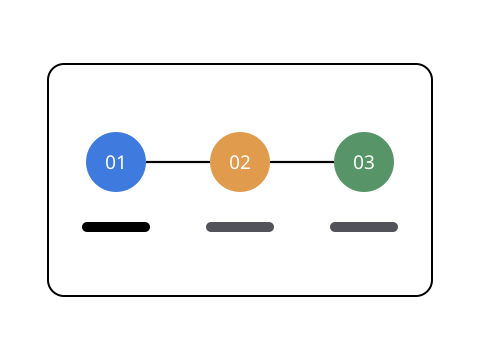<br>
        <code>stepper_journey.svg</code>
      </td>
    </tr>
    <tr>
      <td align="center" width="33%">
        <br>
        <code>team_collaboration.png</code>
      </td>
      <td align="center" width="33%">
        <br>
        <code>timeline_milestones.svg</code>
      </td>
      <td align="center" width="33%">
        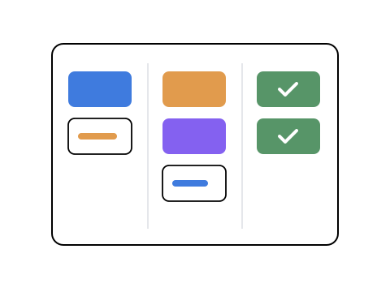<br>
        <code>workflow_sync.svg</code>
      </td>
    </tr>
  </tbody>
</table>

<br>

## **Catálogo SVG Animado (`*_animated.svg` — 19 itens)**

<table>
  <tbody>
    <tr>
      <td align="center" width="33%">
        <br>
        <code>access_governance_animated.svg</code>
      </td>
      <td align="center" width="33%">
        <br>
        <code>ai_shield_animated.svg</code>
      </td>
      <td align="center" width="33%">
        <br>
        <code>api_gateway_animated.svg</code>
      </td>
    </tr>
    <tr>
      <td align="center" width="33%">
        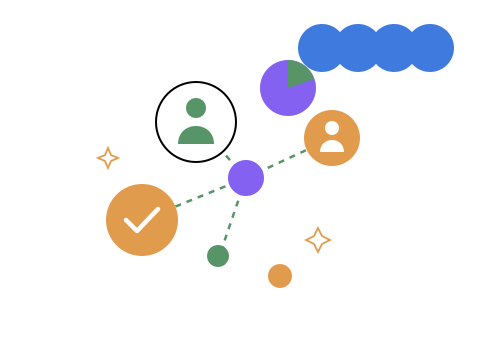<br>
        <code>classification_nodes_animated.svg</code>
      </td>
      <td align="center" width="33%">
        <br>
        <code>cloud_nodes_animated.svg</code>
      </td>
      <td align="center" width="33%">
        <br>
        <code>code_review_animated.svg</code>
      </td>
    </tr>
    <tr>
      <td align="center" width="33%">
        <br>
        <code>coverage_workspace_animated.svg</code>
      </td>
      <td align="center" width="33%">
        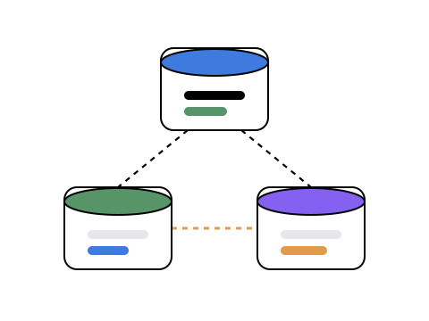<br>
        <code>database_cluster_animated.svg</code>
      </td>
      <td align="center" width="33%">
        <br>
        <code>discovery_analytics_animated.svg</code>
      </td>
    </tr>
    <tr>
      <td align="center" width="33%">
        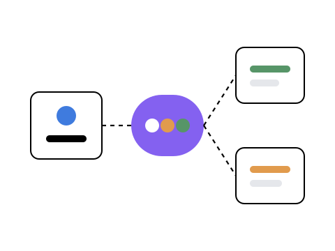<br>
        <code>event_bus_animated.svg</code>
      </td>
      <td align="center" width="33%">
        <br>
        <code>interactive_quiz_animated.svg</code>
      </td>
      <td align="center" width="33%">
        <br>
        <code>lock_verification_animated.svg</code>
      </td>
    </tr>
    <tr>
      <td align="center" width="33%">
        <br>
        <code>metrics_dashboard_animated.svg</code>
      </td>
      <td align="center" width="33%">
        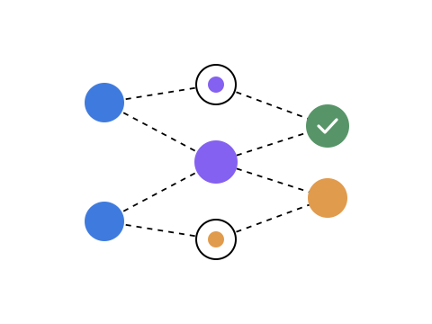<br>
        <code>ml_training_animated.svg</code>
      </td>
      <td align="center" width="33%">
        <br>
        <code>observability_traces_animated.svg</code>
      </td>
    </tr>
    <tr>
      <td align="center" width="33%">
        <br>
        <code>remediation_automation_animated.svg</code>
      </td>
      <td align="center" width="33%">
        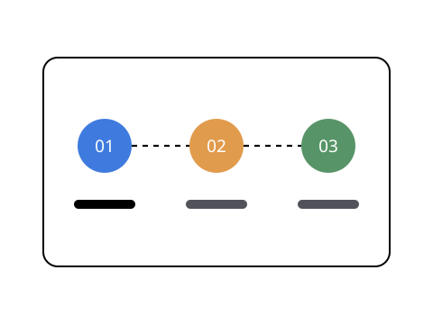<br>
        <code>stepper_journey_animated.svg</code>
      </td>
      <td align="center" width="33%">
        <br>
        <code>timeline_milestones_animated.svg</code>
      </td>
    </tr>
    <tr>
      <td align="center" width="33%">
        <br>
        <code>workflow_sync_animated.svg</code>
      </td>
      <td align="center" width="33%"></td>
      <td align="center" width="33%"></td>
    </tr>
  </tbody>
</table>
