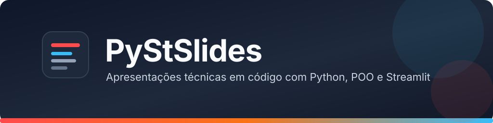
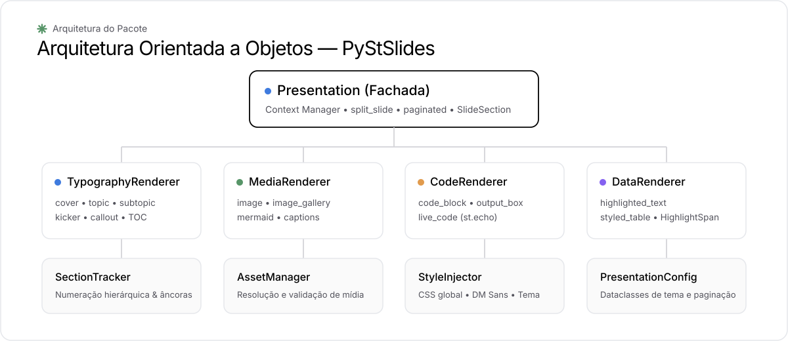

<div align="center">
  
</div>

<br>

-----

<div align="center">
  <strong>Um pacote orientado a objetos em Python sobre Streamlit para automatizar apresentações em código.</strong>
</div>

<br>

<div align="center">
  
  
  
  
</div>

<br>

<p align="center">
  <a href="./TUTORIAL.md">Tutorial</a> •
  <a href="./ASSETS.md">Catálogo de Assets</a> •
  <a href="#estrutura-do-projeto">Estrutura do Projeto</a> •
  <a href="#tecnologias">Tecnologias</a> •
  <a href="#como-executar">Como Executar</a>
</p>

-----

<br>

|**Sobre o Projeto**|
|-|
|O PyStSlides é um pacote Python construído em cima do Streamlit para padronizar e acelerar a criação de apresentações técnicas em código. Projetado com Programação Orientada a Objetos (POO) e composição de componentes, ele centraliza temas tipográficos, numeração hierárquica automática de tópicos e sub-tópicos, gerenciamento de assets, diagramas Mermaid, blocos de código e componentes visuais de dados, servindo como base genérica e reutilizável para futuras apresentações.|

<br>

<div align="center">
  
</div>

<br>

-----

<br>

| **Funcionalidades** |
|---|
| <p align="justify"> Configuração de Tema e Layout Centralizado: <br> <br> - Configura automaticamente a página do Streamlit, injeta fontes e CSS global uma única vez e centraliza o conteúdo via context manager (`with Presentation(...) as deck:`). </p> |
| <p align="justify"> Numeração Hierárquica e Sumário Automático: <br> <br> - Gera numeração automática para tópicos (`01 ) - Título`) e sub-tópicos multinível (`1.1 )`, `1.1.1 )`), além de registrar âncoras e montar um sumário clicável na barra lateral. </p> |
| <p align="justify"> Tipografia, Capas, Listas e Callouts: <br> <br> - Padroniza parágrafos, listas editoriais com marcadores geométricos (`bullets`), cabeçalhos de capa, divisores horizontais, espaçamentos em pixels e caixas de destaque (`info`, `success`, `warning`, `danger`). </p> |
| <p align="justify"> Gerenciamento de Assets e Galerias de Imagens: <br> <br> - Resolve e valida caminhos de mídia a partir de um diretório base via `AssetManager`, oferecendo renderização de imagem única com borda/legenda e galerias em pilha vertical ou grade de colunas. </p> |
| <p align="justify"> Diagramas Mermaid e Demonstrações de Código: <br> <br> - Renderiza diagramas Mermaid em SVG diretamente no Streamlit, remove indentação automática em blocos de código, encapsula saídas estilizadas e fornece suporte a `st.echo` (`live_code`). </p> |
| <p align="justify"> Componentes Visuais de Dados e Interatividade: <br> <br> - Disponibiliza marcação de trechos em texto (`HighlightSpan` / `highlighted_text`), cartões de KPIs (`metrics`), tabelas HTML arredondadas (`styled_table`), cartões de revelação (`reveal_card`), questionários com placar (`quiz` / `quiz_summary`), etapas (`step_tabs`), comparador (`compare_toggle`) e `checklist`. </p> |
| <p align="justify"> Modularização com `SlideSection`: <br> <br> - Permite dividir apresentações extensas em classes/módulos independentes herdando de `SlideSection`, mantendo compartilhados o tema, a numeração e os assets. </p> |

<br>

-----

<br>

## **Estrutura do Projeto**
<br>

```bash
PyStSlides/
├── .github/
│   └── workflows/
│       └── tests.yml                # CI automatizado (unittest + compileall).
├── assets/
│   ├── tutorial/                    # Screenshots de cada módulo do TUTORIAL.md.
│   ├── architecture.svg             # Diagrama visual da arquitetura POO do pacote.
│   └── banner.svg                   # Banner principal do repositório.
├── examples/
│   ├── 01_arquitetura_software/     # Exemplo completo: Tech Talk de Microsserviços.
│   ├── 02_privacidade_dados/        # Exemplo completo: Workshop Data Discovery & LGPD.
│   ├── 03_pitch_produto/            # Exemplo completo: Pitch Executivo SaaS.
│   ├── 04_workshop_interativo/      # Exemplo completo: Quizzes, Stepper, Comparador e Checklist.
│   ├── screenshots/                 # Prints reais das apresentações renderizadas no Streamlit.
│   ├── sections/
│   │   ├── __init__.py
│   │   └── demo_section.py          # Exemplo de seção modularizada com SlideSection.
│   ├── demo_app.py                  # Apresentação mínima de demonstração.
│   └── README.md                    # Guia e galeria de prints dos exemplos completos.
├── src/
│   └── pystslides/
│       ├── __init__.py              # Exporta a API pública e a versão do pacote.
│       ├── assets.py                # AssetManager + exportação/CLI dos assets editoriais.
│       ├── config.py                # Dataclasses PresentationTheme e PresentationConfig.
│       ├── editorial_assets/        # Pacote de 49 ilustrações (PNG, SVG estáticos e SVG animados).
│       ├── exceptions.py            # Exceções customizadas do pacote.
│       ├── numbering.py             # SectionTracker e SectionEntry (numeração + âncoras).
│       ├── presentation.py          # Fachada Presentation (context manager e API unificada).
│       ├── section.py               # Classe base abstrata SlideSection para modularização.
│       ├── styles.py                # StyleInjector: geração e injeção única de CSS global.
│       └── components/
│           ├── __init__.py
│           ├── base.py              # BaseComponent e utilitários de container/colunas.
│           ├── code.py              # CodeRenderer: blocos de código, output_box e live_code.
│           ├── data.py              # DataRenderer, HighlightSpan, metrics e tabelas HTML.
│           ├── interactive.py       # InteractiveRenderer: quiz, step_tabs, compare_toggle, checklist e reveal_card.
│           ├── media.py             # MediaRenderer: imagens, galerias e Mermaid em SVG.
│           └── typography.py        # TypographyRenderer: tópicos, bullets, callouts e TOC.
├── tests/
│   ├── fakes.py                     # Dublê do Streamlit para testes unitários isolados.
│   ├── test_assets.py               # Testes do AssetManager e exportação de assets.
│   ├── test_components.py           # Testes dos renderizadores de tipografia, mídia, código e dados.
│   ├── test_numbering.py            # Testes da numeração hierárquica e âncoras únicas.
│   └── test_presentation.py         # Testes integrados da fachada Presentation e SlideSection.
├── .gitignore
├── LICENSE
├── pyproject.toml                   # Configuração PEP 621 para empacotamento e instalação.
├── README.md
├── TUTORIAL.md                      # Tutorial passo a passo no padrão visual do projeto.
└── requirements.txt                 # Dependências mínimas de execução.
```

<br>

## **Tecnologias**

<br>

| Ferramenta | Descrição |
|-----------|----------------------------------------------------------------|
| **Python 3.10+** | Linguagem principal utilizada na arquitetura orientada a objetos do pacote. |
| **Streamlit** | Framework web sobre o qual os slides e componentes interativos são renderizados. |
| **Setuptools (`pyproject.toml`)** | Empacotamento moderno (PEP 621) permitindo instalar o pacote em outros projetos via `pip`. |
| **Unittest / Pytest** | Suíte de testes automatizados para validar numeração, assets, HTML e a fachada `Presentation`. |

<br>

## **Como Executar**

<br>

Para instalar o pacote localmente, executar a apresentação de demonstração ou utilizá-lo em seus projetos, siga os passos abaixo.

<details>
  <summary><strong>Pré-requisitos</strong></summary>

  - Python 3.10 ou superior instalado na sua máquina.
  - Git instalado para clonar o repositório.
  - Um ambiente virtual (`venv`) recomendado para isolar as dependências.

</details>

<details>
  <summary><strong>Instalação e Execução do Exemplo</strong></summary>

<br>

1 ) **Clone o repositório:**

```bash
git clone https://github.com/OfAndreS/PyStSlides.git
```

2 ) **Acesse o diretório do projeto:**

```bash
cd PyStSlides
```

3 ) **Crie e ative um ambiente virtual:**

```bash
# Linux / macOS
python3 -m venv .venv && source .venv/bin/activate

# Windows (PowerShell)
python -m venv .venv; .\.venv\Scripts\Activate.ps1
```

4 ) **Instale o pacote em modo editável:**

```bash
pip install -e .
```

5 ) **Execute um dos sites de slides de exemplo:**

```bash
# Demonstração rápida
streamlit run examples/demo_app.py

# Exemplos completos (veja os prints em examples/README.md)
streamlit run examples/01_arquitetura_software/app.py
streamlit run examples/02_privacidade_dados/app.py
streamlit run examples/03_pitch_produto/app.py
streamlit run examples/04_workshop_interativo/app.py
```

</details>

<details>
  <summary><strong>Como Estruturar e Usar em Novos Projetos</strong></summary>

<br>

Mantenha o `PyStSlides` isolado no próprio repositório como uma biblioteca reutilizável e crie cada apresentação em uma pasta/repositório separado.

1 ) **Estrutura recomendada para uma apresentação que consome o pacote:**

```bash
MinhaApresentacao/
├── data/                       # Imagens, CSVs e arquivos de mídia da apresentação.
├── src/
│   ├── app.py                  # Arquivo principal que instancia Presentation.
│   └── sections/               # Tópicos modularizados usando SlideSection.
│       ├── __init__.py
│       └── introducao.py
├── requirements.txt            # Lista o PyStSlides e demais dependências.
└── README.md
```

2 ) **Instale o `PyStSlides` no ambiente virtual da apresentação:**

```bash
# Via GitHub (recomendado para produção e Streamlit Cloud)
pip install git+https://github.com/OfAndreS/PyStSlides.git

# Ou em modo editável local (quando estiver evoluindo o pacote em paralelo)
pip install -e ../PyStSlides
```

Você também pode declarar diretamente no `requirements.txt` da apresentação:

```txt
git+https://github.com/OfAndreS/PyStSlides.git
```

3 ) **Crie o ponto de entrada em `src/app.py`:**

```python
from pystslides import HighlightSpan, Presentation, get_editorial_assets_dir

with Presentation(
    title="Data Discovery",
    assets_dir=get_editorial_assets_dir(),
    auto_number=False,
    brand_label="Data Discovery",
    show_toc=True,
) as deck:
    deck.cover(
        title="Data Discovery",
        subtitle="Mapeamento e classificação de dados sensíveis",
        image="discovery_cover.png",
        image_position="right",
    )

    deck.topic("Implementação do Data Discovery")
    deck.bullets(
        [
            "Descoberta automática em bancos e nuvem",
            "Classificação com modelos e regras",
        ]
    )
    deck.mermaid("graph LR\n    Entrada --> Classificador --> Anonimizacao")

    deck.highlighted_text(
        "Contato: suporte@exemplo.com",
        spans=[HighlightSpan.from_score(9, 28, "EMAIL", 0.95)],
    )
    deck.reveal_card(
        prompt="Por que mascarar antes de enviar prompts para LLMs externos?",
        answer="Evita vazamento de dados pessoais (PII) para terceiros.",
        title="Privacidade na prática",
    )
```

4 ) **Execute a apresentação normalmente com Streamlit:**

```bash
streamlit run src/app.py
```

</details>

<details>
  <summary><strong>Como Atualizar a Biblioteca no Seu Projeto (Conda / venv)</strong></summary>

<br>

1 ) **Atualizar a partir do GitHub no ambiente ativo (Conda ou `venv`):**

```bash
conda activate Streamlit   # ou ative seu venv
pip install --upgrade --force-reinstall --no-deps git+https://github.com/OfAndreS/PyStSlides.git
```

2 ) **Atualizar direto do repositório local (sem esperar push no GitHub):**

```bash
# Modo editável (recomendado durante desenvolvimento)
pip install -e /caminho/para/PyStSlides --no-deps

# Ou reinstalação normal a partir da pasta local
pip install --upgrade --force-reinstall --no-deps /caminho/para/PyStSlides
```

3 ) **Confirmar a versão e o local carregado pelo Python:**

```bash
python -c "import pystslides; print(pystslides.__file__, pystslides.__version__)"
```

</details>

<details>
  <summary><strong>Como Baixar os Assets Editoriais Rapidamente</strong></summary>

<br>

O pacote já inclui **49 ilustrações editoriais** (`11 PNG`, `19 SVG` estáticos e `19 SVG` animados com sufixo `_animated.svg`) prontas para montar apresentações no mesmo estilo dos exemplos — veja a prévia completa em [ASSETS.md](./ASSETS.md).

1 ) **Exportar para a pasta do seu projeto após instalar o `PyStSlides` (recomendado):**

```bash
# Copia todos os PNGs e SVGs (estáticos e animados) para ./assets
pystslides-assets ./assets

# Ou usando o módulo Python diretamente (all, png, svg, svg_static ou svg_animated)
python -m pystslides.assets ./assets --format svg_animated
```

2 ) **Usar direto em código Python sem copiar arquivos manualmente:**

```python
from pystslides import Presentation, export_editorial_assets, get_editorial_assets_dir

# Opção A: usar direto do pacote instalado
with Presentation(title="Minha Palestra", assets_dir=get_editorial_assets_dir()) as deck:
    deck.cover(title="Minha Palestra", image="discovery_cover.png", image_position="right")

# Opção B: copiar via código para uma pasta local
export_editorial_assets("./assets", kind="all")
```

3 ) **Baixar apenas a pasta de assets do GitHub (sem instalar o pacote):**

```bash
git clone --filter=blob:none --no-checkout https://github.com/OfAndreS/PyStSlides.git temp-assets
cd temp-assets && git sparse-checkout set src/pystslides/editorial_assets && git checkout
```

</details>

<details>
  <summary><strong>Executando os Testes</strong></summary>

<br>

```bash
# Usando a biblioteca padrão (sem dependências extras)
PYTHONPATH=src python3 -m unittest discover -s tests -v

# Ou com pytest (caso tenha instalado `pip install -e ".[dev]"`)
pytest -v
```

</details>
