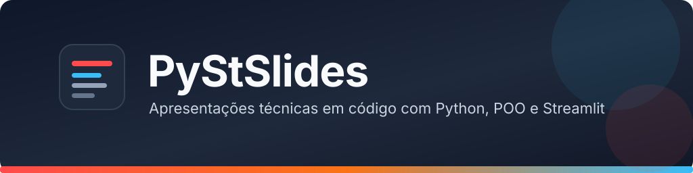
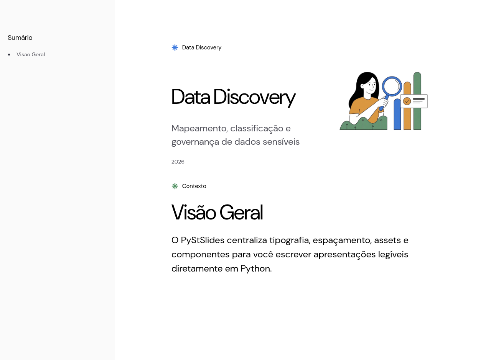
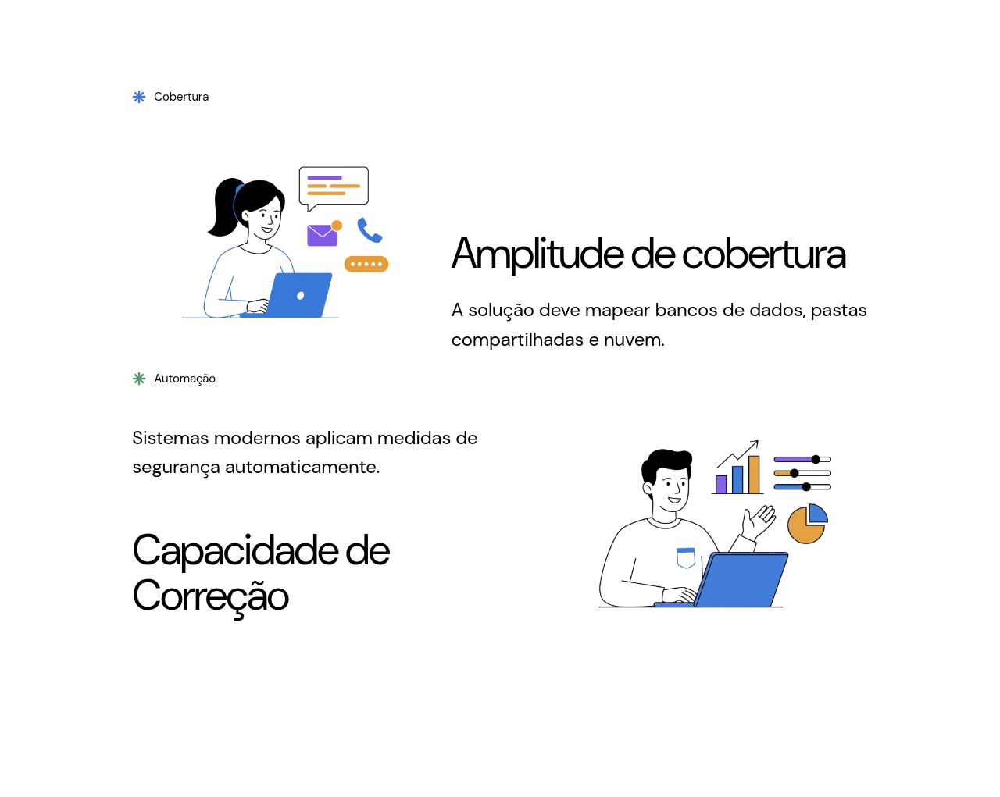
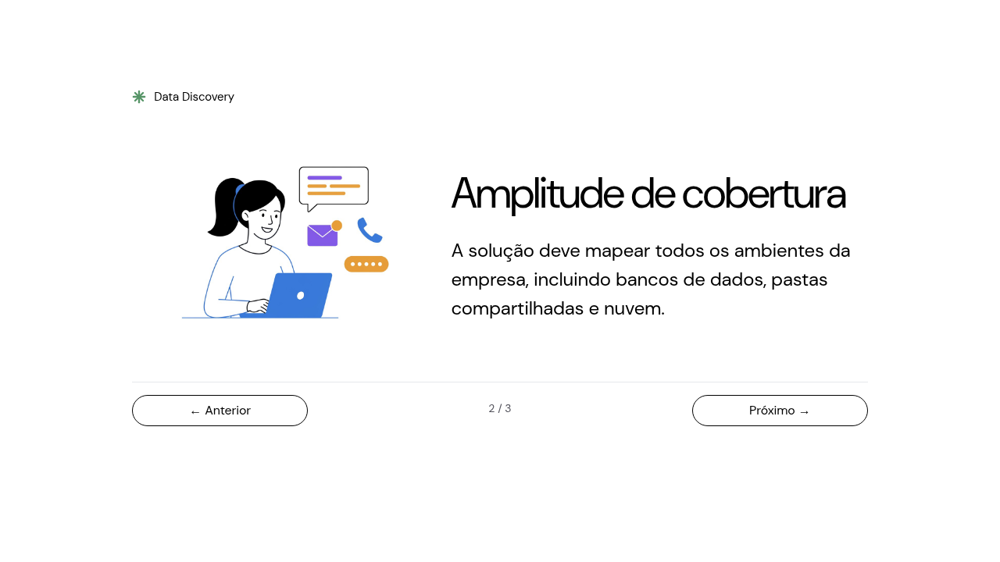
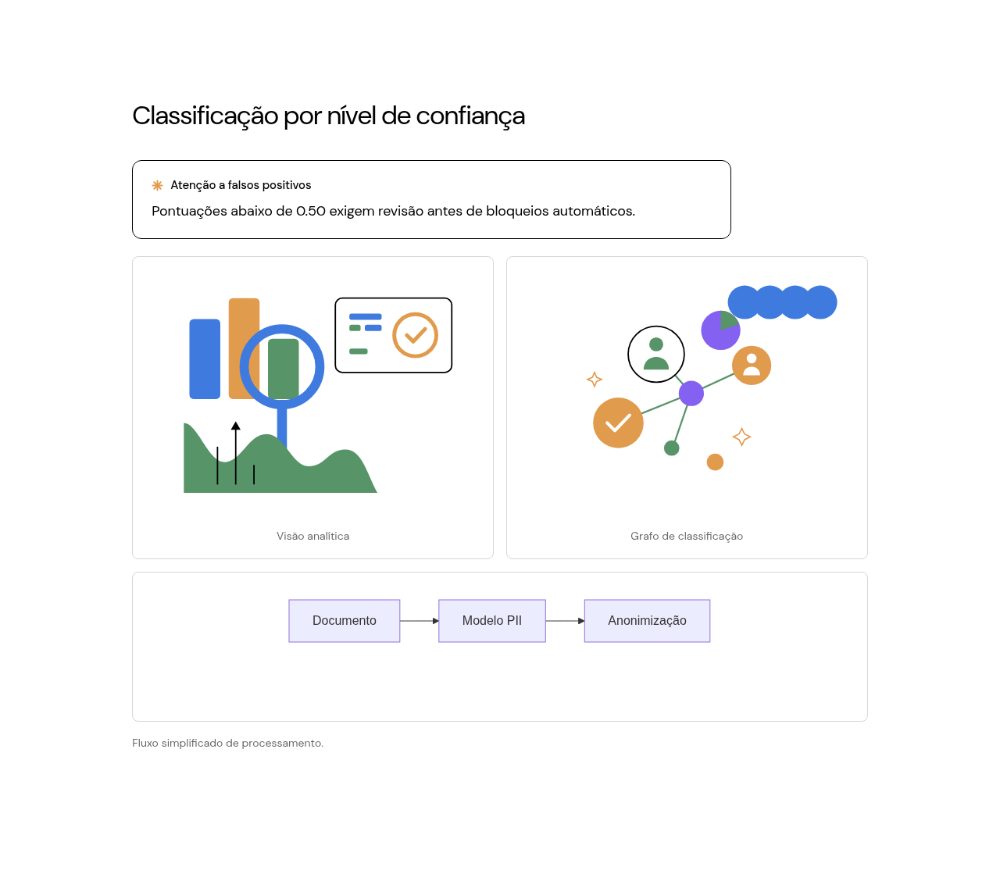
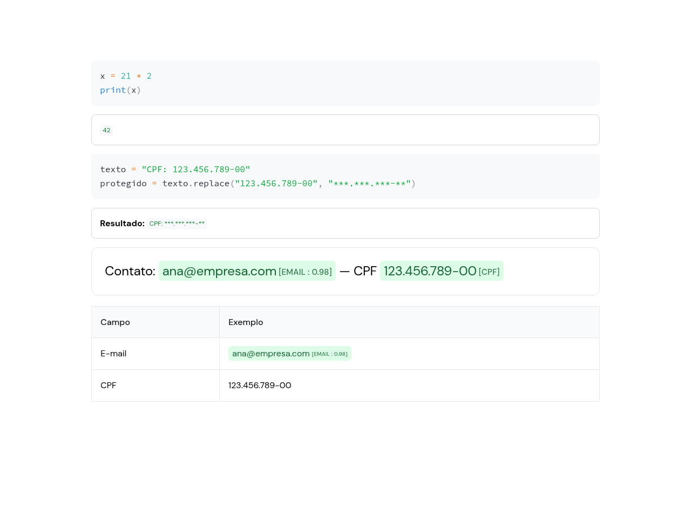
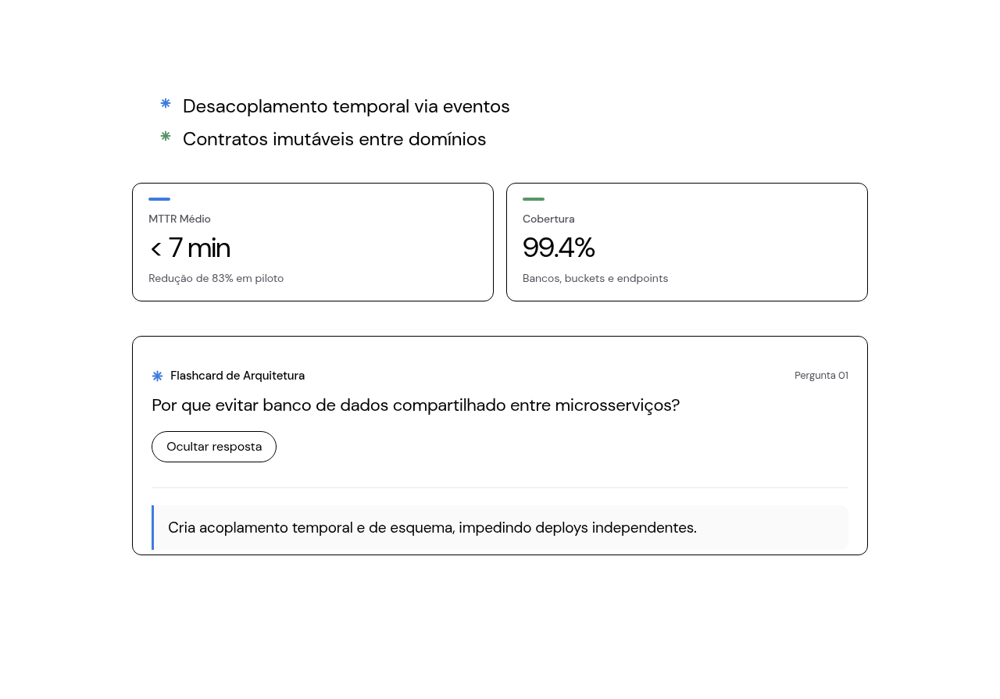
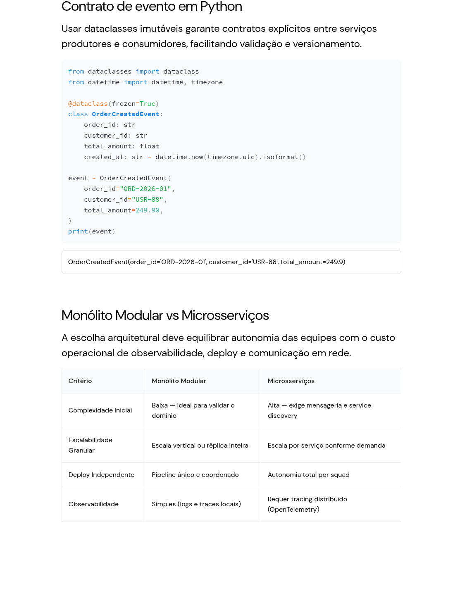
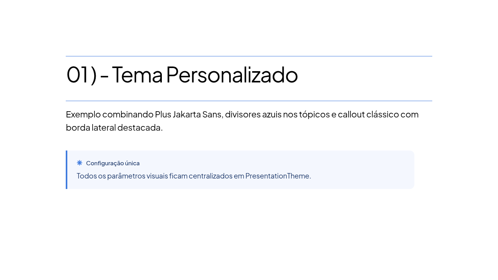

<div align="center">
  
</div>

<br>

-----

<div align="center">
  <strong>Tutorial passo a passo para criar apresentações editoriais e técnicas em Python com o PyStSlides.</strong>
</div>

<br>

<p align="center">
  <a href="#primeiros-passos">Primeiros Passos</a> •
  <a href="#layout-editorial-e-paginacao">Layout Editorial</a> •
  <a href="#componentes-visuais">Componentes</a> •
  <a href="#modularizacao-e-assets">Modularização</a> •
  <a href="#personalizacao-de-tema">Tema</a> •
  <a href="./README.md">README</a>
</p>

-----

<br>

|**Sobre este Tutorial**|
|-|
|Este guia acompanha a criação de uma apresentação completa do zero usando o **PyStSlides** — desde a instalação e o primeiro slide até composições em duas colunas com ilustrações, modo paginado, destaques em texto/tabelas, modularização com `SlideSection` e personalização de `PresentationTheme`.|

<br>

-----

<br>

## **Primeiros Passos**
<br>

<details open>
  <summary><strong>Sua Primeira Apresentação em 4 Passos</strong></summary>

<br>

1 ) **Instale o pacote no seu ambiente virtual:**

```bash
pip install -e .
# ou diretamente do GitHub:
# pip install git+https://github.com/OfAndreS/PyStSlides.git
```

2 ) **Organize uma pasta de projeto e baixe os assets editoriais do pacote:**

```bash
mkdir -p MinhaApresentacao && cd MinhaApresentacao
pystslides-assets ./assets
```

Estrutura gerada:

```bash
MinhaApresentacao/
├── assets/
│   ├── discovery_cover.png
│   ├── coverage_laptop.png
│   └── ... (22 ilustrações PNG e SVG)
└── app.py
```

3 ) **Crie o arquivo `app.py` usando o context manager `Presentation`:**

```python
from pathlib import Path
from pystslides import Presentation

ASSETS_DIR = Path(__file__).resolve().parent / "assets"

with Presentation(
    title="Data Discovery",
    assets_dir=ASSETS_DIR,
    auto_number=False,
    brand_label="Data Discovery",
    show_toc=True,
) as deck:
    deck.cover(
        title="Data Discovery",
        subtitle="Mapeamento, classificação e governança de dados sensíveis",
        date="2026",
        image="discovery_cover.png",
        image_position="right",
    )

    deck.topic("Visão Geral", kicker="Contexto")
    deck.paragraph(
        "O PyStSlides centraliza tipografia, espaçamento, assets e componentes "
        "para você escrever apresentações legíveis diretamente em Python."
    )
```

4 ) **Execute com o Streamlit:**

```bash
streamlit run app.py
```

<div align="center">
  
</div>

</details>

<br>

-----

<br>

## **Layout Editorial e Paginação**
<br>

<details>
  <summary><strong>Capas em Duas Colunas, <code>split_slide</code> e Modo Paginado</strong></summary>

<br>

1 ) **Capa assimétrica (`image_position="right"`):**

Posiciona título, subtítulo e metadados à esquerda e a ilustração à direita, com o cabeçalho discreto (`brand_label`) no topo esquerdo.

```python
deck.cover(
    title="Data Discovery",
    date="20 Julho, 2026",
    image="discovery_cover.png",
    image_position="right",
)
```

2 ) **Slides em duas colunas (`split_slide`):**

Alterne `media_position` entre `"left"` e `"right"`, defina a altura da mídia com `media_vertical_align` (`"top"`, `"center"` ou `"bottom"`) ou use `title_bottom=True` para posicionar o título abaixo do parágrafo:

```python
deck.split_slide(
    "Amplitude de cobertura",
    "A solução deve mapear bancos de dados, pastas compartilhadas e nuvem.",
    media="coverage_laptop.png",
    media_position="left",
    media_vertical_align="bottom",  # "top" | "center" | "bottom"
    kicker="Cobertura",
)

deck.split_slide(
    "Capacidade de Correção",
    "Sistemas modernos aplicam medidas de segurança automaticamente.",
    media="remediation_analytics.png",
    media_position="right",
    media_vertical_align="center",
    title_bottom=True,
    kicker="Automação",
)
```

<div align="center">
  
</div>

3 ) **Modo apresentação paginado (`paginated=True`):**

Por padrão, o conteúdo é exibido em fluxo vertical contínuo (ideal para rolagem e leitura). Ative `paginated=True` para renderizar **um slide por tela** com barra `← Anterior | X / N | Próximo →`:

```python
with Presentation(
    title="Data Discovery",
    assets_dir=ASSETS_DIR,
    auto_number=False,
    brand_label="Data Discovery",
    paginated=True,
) as deck:
    ...
```

<div align="center">
  
</div>

| Parâmetro de `Presentation` | Padrão | Descrição |
|---|---|---|
| `auto_number` | `True` | Numera tópicos (`01 ) - ...`) e subtópicos (`1.1 ) ...`) automaticamente. |
| `brand_label` | `None` | Exibe um cabeçalho discreto com ícone geométrico colorido na capa. |
| `repeat_brand_kicker` | `False` | Repete o `brand_label` em todos os tópicos no modo scroll contínuo. |
| `paginated` | `False` | Renderiza um slide por vez com controles de navegação inferior. |
| `show_toc` | `False` | Gera sumário clicável automático na barra lateral. |

</details>

<br>

-----

<br>

## **Componentes Visuais**
<br>

<details>
  <summary><strong>Callouts, Galerias, Mermaid, Código e Dados Estruturados</strong></summary>

<br>

1 ) **Hierarquia de subtítulos e notas (`subtopic` e `callout`):**

```python
deck.subtopic("Classificação por nível de confiança")
deck.callout(
    "Pontuações abaixo de 0.50 exigem revisão antes de bloqueios automáticos.",
    title="Atenção a falsos positivos",
    variant="warning",  # info | success | warning | danger | neutral
)
```

2 ) **Galerias de imagens e diagramas Mermaid (`image_gallery` e `mermaid`):**

```python
deck.image_gallery(
    [
        ("discovery_analytics.svg", "Visão analítica"),
        ("classification_nodes.svg", "Grafo de classificação"),
    ],
    columns=2,
    bordered=True,
)

deck.mermaid(
    """
    flowchart LR
        Entrada[Documento] --> Classificador[Modelo PII]
        Classificador --> Acao[Anonimização]
    """,
    caption="Fluxo simplificado de processamento.",
)
```

<div align="center">
  
</div>

3 ) **Blocos de código e demonstração ao vivo (`code_block` e `live_code`):**

```python
deck.code_block(
    """
    x = 21 * 2
    print(x)
    """,
    language="python",
    output=42,
)

with deck.live_code():
    texto = "CPF: 123.456.789-00"
    protegido = texto.replace("123.456.789-00", "***.***.***-**")

deck.output_box(f"**Resultado:** `{protegido}`", as_markdown=True)
```

4 ) **Texto destacado e tabelas estilizadas (`highlighted_text` e `styled_table`):**

```python
from pystslides import HighlightLevel, HighlightSpan

texto = "Contato: ana@empresa.com — CPF 123.456.789-00"
spans = [
    HighlightSpan.from_score(9, 24, "EMAIL", 0.98),
    HighlightSpan(31, 45, "CPF", level=HighlightLevel.HIGH),
]
deck.highlighted_text(texto, spans=spans)

deck.styled_table(
    {
        "Campo": ["E-mail", "CPF"],
        "Exemplo": ["ana@empresa.com", "123.456.789-00"],
    },
    highlights={("Exemplo", 0): [HighlightSpan.from_score(0, 15, "EMAIL", 0.98)]},
)
```

<div align="center">
  
</div>

5 ) **Cartões de revelação interativos (`reveal_card`), listas (`bullets`) e KPIs (`metrics`):**

Para perguntas ao vivo, flashcards ou ocultação de spoilers antes da explicação oral, use `deck.reveal_card(...)` (suporta texto, lista de parágrafos ou função `callable` com código/gráficos), além de `deck.bullets([...])` e `deck.metrics([...])`:

```python
deck.bullets(
    [
        "Desacoplamento temporal via eventos",
        "Contratos imutáveis entre domínios",
    ]
)

deck.metrics(
    [
        ("MTTR Médio", "< 7 min", "Redução de 83% em piloto"),
        ("Cobertura", "99.4%", "Bancos, buckets e endpoints"),
    ]
)

deck.reveal_card(
    prompt="Por que evitar banco de dados compartilhado entre microsserviços?",
    answer="Cria acoplamento temporal e de esquema, impedindo deploys independentes.",
    title="Flashcard de Arquitetura",
    kicker="Pergunta 01",
    reveal_label="Revelar resposta",
    hide_label="Ocultar resposta",
)
```

<div align="center">
  
</div>

</details>

<br>

-----

<br>

## **Modularização e Assets**
<br>

<details>
  <summary><strong>Dividindo Apresentações Grandes com <code>SlideSection</code> e <code>AssetManager</code></strong></summary>

<br>

1 ) **Estrutura recomendada para projetos maiores:**

```bash
MinhaApresentacao/
├── assets/
│   ├── discovery_cover.png
│   └── coverage_laptop.png
├── sections/
│   ├── __init__.py
│   └── deteccao_pii.py
└── app.py
```

2 ) **Encapsule cada tópico em `sections/deteccao_pii.py`:**

```python
from pystslides import Presentation, SlideSection

class PiiDetectionSection(SlideSection):
    title = "Detecção Visual em Textos e Tabelas"

    def render(self, presentation: Presentation) -> None:
        presentation.subtopic("Classificação por confiança")
        presentation.paragraph("Cada entidade recebe um selo colorido automático.")
```

3 ) **Registre as seções no arquivo principal `app.py`:**

```python
from sections.deteccao_pii import PiiDetectionSection

with Presentation(title="Workshop", assets_dir="assets") as deck:
    deck.add_sections([PiiDetectionSection()])
```

4 ) **Resolvendo caminhos relativos com `AssetManager`:**

Quando `assets_dir` é configurado em `Presentation`, você passa apenas o nome do arquivo (`"discovery_cover.png"`). Se precisar validar ou listar imagens fora da fachada, use `AssetManager.from_file(__file__, "assets")`.

<div align="center">
  
</div>

</details>

<br>

-----

<br>

## **Personalização de Tema**
<br>

<details>
  <summary><strong>Ajustando Tipografia, Cores e Comportamento via <code>PresentationTheme</code></strong></summary>

<br>

Por padrão, o `PresentationTheme` utiliza **DM Sans**, fundo `#ffffff`, texto `#000000`, alinhamento à esquerda, títulos sem negrito (`400`) e limpeza da barra superior do Streamlit (`clean_chrome=True`). Você pode sobrescrever qualquer propriedade:

```python
from pystslides import Presentation, PresentationTheme

tema_customizado = PresentationTheme(
    font_family="Plus Jakarta Sans",
    google_font_url="https://fonts.googleapis.com/css2?family=Plus+Jakarta+Sans:wght@400;500;700&display=swap",
    paragraph_font_size="22px",
    paragraph_max_width="68ch",
    divider_color="#3f7bde",
    topic_dividers=True,
    callout_minimal=False,
    clean_chrome=True,
)
# Ou use um preset pronto: PresentationTheme.editorial() | .compact() | .classic()

with Presentation(title="Minha Apresentação", theme=tema_customizado) as deck:
    deck.topic("Tema Personalizado")
    deck.paragraph(
        "Exemplo combinando Plus Jakarta Sans, divisores azuis nos tópicos e "
        "callout clássico com borda lateral destacada."
    )
    deck.callout(
        "Todos os parâmetros visuais ficam centralizados em PresentationTheme.",
        title="Configuração única",
        variant="info",
    )
```

| Atributo de `PresentationTheme` | Padrão | Efeito visual |
|---|---|---|
| `font_family` | `"DM Sans"` | Fonte principal carregada via `google_font_url`. |
| `accent_colors` | `("#3f7bde", "#579568", "#e19b4d", "#8461f0")` | Paleta alternada automaticamente nos ícones de kicker. |
| `cover_title_font_size` | `"76px"` | Tamanho do título principal na capa. |
| `topic_font_size` | `"54px"` | Tamanho dos títulos de tópico (`H1`). |
| `paragraph_font_size` | `"24px"` | Tamanho base do texto corrido e cards. |
| `paragraph_max_width` | `"62ch"` | Limita a largura da linha para leitura confortável. |
| `table_font_size` | `"18px"` | Tamanho da fonte das tabelas HTML. |
| `code_font_size` | `"16px"` | Tamanho da fonte dos blocos de código. |
| `card_border_color` | `"#000000"` | Cor da borda de cards, callouts, tabelas, KPIs e `reveal_card`. |
| `topic_dividers` | `False` | Adiciona divisores horizontais acima e abaixo de cada tópico. |
| `callout_minimal` | `True` | Usa card branco com borda `#000000` (`1.5px`) e asterisco colorido em vez de barra lateral. |
| `table_rounded` | `True` | Renderiza tabela editorial com bordas arredondadas `#000000` (`12px`) em vez de tabela aberta. |
| `clean_chrome` | `True` | Oculta toolbar, botão Deploy e rodapé padrão do Streamlit. |
| `default_media_vertical_align` | `"top"` | Alinhamento vertical padrão da mídia (`"top"`, `"center"`, `"bottom"`) em `cover` e `split_slide`. |

<div align="center">
  
</div>

</details>
