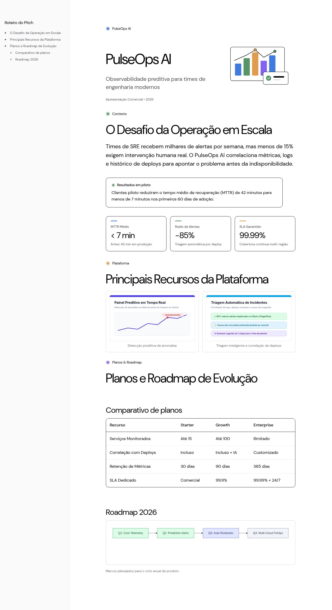

# Exemplos Completos de Sites de Slides — PyStSlides

Esta pasta reúne implementações completas de apresentações criadas com o **PyStSlides**, utilizando as ilustrações editoriais incluídas no pacote (`pystslides-assets`).

## Como executar qualquer exemplo

A partir da raiz do repositório (com o pacote instalado via `pip install -e .`):

```bash
# Demonstração básica com ilustrações editoriais SVG
streamlit run examples/demo_app.py

# 01 — Arquitetura de Microsserviços (Tech Talk)
streamlit run examples/01_arquitetura_software/app.py

# 02 — Workshop Data Discovery & LGPD (Ilustrações editoriais + destaques PII + st.echo)
streamlit run examples/02_privacidade_dados/app.py

# 03 — Pitch Executivo de Produto SaaS (Tema Editorial + Roadmap Mermaid)
streamlit run examples/03_pitch_produto/app.py
```

---

## Prévia dos Resultados

### 1. Arquitetura de Microsserviços (`01_arquitetura_software`)
- Capa customizada, sumário lateral automático, diagrama Mermaid em SVG, galeria em 2 colunas com bordas, seção modular (`SlideSection`), bloco de código com saída, tabela editorial arredondada e cartão interativo (`reveal_card`).


### 2. Workshop Data Discovery & LGPD (`02_privacidade_dados`)
- Capa e 4 slides em duas colunas (`split_slide`) com as ilustrações editoriais, fluxo Mermaid de proteção de LLMs, `st.slider` interativo de confiança para `highlighted_text`, `styled_table`, callout, `live_code` (`st.echo`) e `reveal_card` de boas práticas.


### 3. Pitch Executivo de Produto SaaS (`03_pitch_produto`)
- Tema editorial limpo (**DM Sans**) com kicker de marca, callout de impacto, grade de KPIs (`metrics`), galeria de recursos em 2 colunas, comparativo de planos em tabela estilizada e roadmap horizontal em Mermaid.



> Dica: execute também `streamlit run examples/demo_app.py` para testar o toggle de **modo paginado** na barra lateral com navegação direta pelo sumário, listas `bullets` e `reveal_card` com código.
