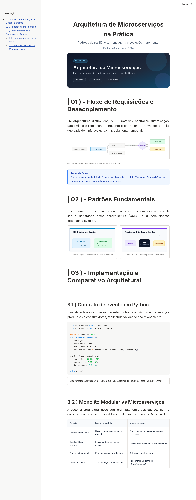
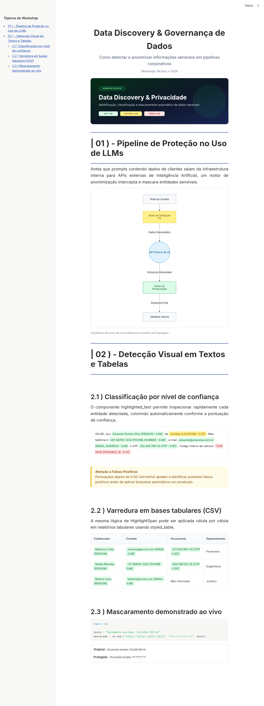

# Exemplos Completos de Sites de Slides — PyStSlides

Esta pasta reúne implementações completas de apresentações criadas com o **PyStSlides**, cada uma com tema, assets, seções e componentes próprios.

## Como executar qualquer exemplo

A partir da raiz do repositório (com o pacote instalado via `pip install -e .`):

```bash
# 01 — Arquitetura de Microsserviços (Tech Talk)
streamlit run examples/01_arquitetura_software/app.py

# 02 — Workshop Data Discovery & LGPD (Destaques PII em texto e tabelas + st.echo)
streamlit run examples/02_privacidade_dados/app.py

# 03 — Pitch Executivo de Produto SaaS (Tema Plus Jakarta Sans + Roadmap Mermaid)
streamlit run examples/03_pitch_produto/app.py
```

---

## Prévia dos Resultados

### 1. Arquitetura de Microsserviços (`01_arquitetura_software`)
- Capa customizada, sumário lateral automático, diagrama Mermaid, galeria em 2 colunas com bordas, seção modular (`SlideSection`), bloco de código com saída e tabela comparativa.



### 2. Workshop Data Discovery & LGPD (`02_privacidade_dados`)
- Fluxo Mermaid de proteção de LLMs, `highlighted_text` com pontuação de confiança (`HighlightSpan.from_score`), `styled_table` com células destacadas, callout de alerta e demonstração ao vivo via `live_code` (`st.echo`) + `output_box`.



### 3. Pitch Executivo de Produto SaaS (`03_pitch_produto`)
- Tema personalizado com fonte **Plus Jakarta Sans** e divisores índigo, callout de impacto, galeria de recursos em 2 colunas, comparativo de planos em tabela estilizada e roadmap horizontal em Mermaid.


